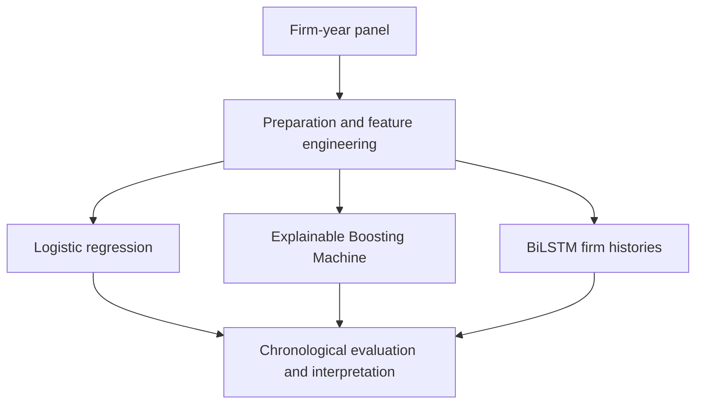

# Bankruptcy Prediction with Explainable AI

**An empirical comparison of econometric, interpretable machine-learning and deep-learning approaches on Slovak firm data.**

[Read the thesis](Diplomova_praca.pdf) · [Explore the notebooks](notebooks/README.md) · [Reproduce the workflow](docs/REPRODUCIBILITY.md) · [Slovenský prehľad](docs/PREHLAD_SK.md)

[](https://doi.org/10.5281/zenodo.20029429)
[](LICENSE)

## Research question

How do logistic regression, an Explainable Boosting Machine (EBM), and a bidirectional LSTM compare when identifying firm failure from financial statements and firm histories?

This diploma-thesis project connects financial feature engineering, rare-event classification, chronological evaluation, probability calibration, and model interpretation. It examines both predictive ranking and how a model's predictions can be explained.

**Author:** Matej Kovacs · **Institution:** University of Economics in Bratislava (EUBA) · **Year:** 2026

## Project at a glance

| Dimension | Implementation |
|---|---|
| Data | Slovak firm-year panel; source data described as covering 2011–2019 |
| Preparation | Accounting ratios, firm characteristics, industry indicators, macroeconomic controls, lag and difference features |
| Training | 2013–2016 |
| Validation | 2017 |
| Test | 2018–2019 |
| Model families | Logistic regression · EBM · BiLSTM |
| Evaluation | ROC-AUC, average precision, calibration, threshold metrics and top-k capture |
| Interpretation | Logit coefficients · EBM shape functions and interactions · BiLSTM SHAP analysis |
| Public materials | Four source notebooks, thesis PDF, environment specifications and documentation |

## Three complementary approaches

| Model | Role | Implemented techniques | Interpretation |
|---|---|---|---|
| **Logistic regression** | Econometric benchmark | Feature screening, collinearity and rank checks, model diagnostics | Coefficients and odds ratios |
| **EBM** | Interpretable nonlinear model | Sampling-strategy comparison, Optuna tuning, sigmoid calibration on validation probabilities | Additive shape functions and pairwise interactions |
| **BiLSTM** | Model of firm histories | Four-step windows, two recurrent layers, industry embedding, temporal attention, focal loss, balanced batches, five-seed ensemble and isotonic calibration | SHAP for a separately retrained explanatory model |

The SHAP analysis concerns the single-seed explanatory model; it is not a direct explanation of the complete calibrated ensemble. Details and evaluation caveats are in the [methodology guide](docs/METHODOLOGY.md).

## Explore the evidence

- **Start with the [thesis PDF](Diplomova_praca.pdf)** for the academic narrative and reported empirical findings.
- **Read the [notebooks](notebooks/README.md)** to inspect preprocessing, model fitting and evaluation code.
- **Use the [data specification](data/README.md)** and [reproduction guide](docs/REPRODUCIBILITY.md) to prepare a local run with authorized data.

The public notebooks have cleared outputs. A standalone table of verified final model metrics and selected result figures has not yet been included. Consequently, this page does not assert a winning model or publish unverified performance numbers.

## Workflow



| Order | Notebook | Main input |
|---|---|---|
| 1 | [Data preparation](notebooks/00_data_preparation.ipynb) | `firmy_dataset.csv` |
| 2 | [Logistic benchmark](notebooks/01_logit_benchmark.ipynb) | `data_logit_strict.csv` |
| 3 | [EBM pipeline](notebooks/03_ebm_pipeline.ipynb) | `data_ebm.csv` |
| 4 | [BiLSTM pipeline](notebooks/04_bilstm_pipeline.ipynb) | `data_rnn.csv` |

Run preparation first; the three model notebooks then use its exports independently. Notebook numbering preserves the original research sequence; there is no required notebook `02` in this package.

## Get started

Source data are not distributed. Reading the thesis, code and documentation requires no local setup.

To run the notebooks with authorized data, clone the repository and create an environment:

```bash
git clone https://github.com/matejkovacs/bankruptcy-prediction-xai-slovak-firms.git
cd bankruptcy-prediction-xai-slovak-firms
python -m venv .venv
```

Activate the environment:

| Platform | Command |
|---|---|
| Windows PowerShell | `.venv\Scripts\Activate.ps1` |
| Linux / macOS | `source .venv/bin/activate` |

```bash
python -m pip install --upgrade pip
python -m pip install -r requirements.txt
python -m jupyterlab
```

Place `firmy_dataset.csv` in the repository root, then open the notebooks in the order above. Alternatively, export `DATA_DIR` before launching Jupyter. BiLSTM also supports `BASE_DIR`. See [configuration and environment limitations](docs/REPRODUCIBILITY.md).

The dependency files specify version ranges, not a verified lockfile. Installing the environment alone does not establish that the thesis results have been reproduced.

## Repository guide

| Location | Contents |
|---|---|
| [Diplomova_praca.pdf](Diplomova_praca.pdf) | Thesis |
| [notebooks/](notebooks/) | Research implementation |
| [data/README.md](data/README.md) | Source format and derived datasets |
| [docs/](docs/) | Methodology, reproduction instructions and review notes |
| [outputs/README.md](outputs/README.md) | Generated artifact inventory |
| [requirements.txt](requirements.txt) / [environment.yml](environment.yml) | pip / conda environment specifications |
| [.env.example](.env.example) | Configuration reference; not automatically loaded |
| [CITATION.cff](CITATION.cff) | Machine-readable software citation |

## Reuse and citation

The repository's existing [MIT license](LICENSE) covers the code, notebooks and documentation as described in this package. Raw data, derived datasets and model artifacts are not distributed under that license. See the [data notes](data/README.md).

For the archived software version, use the existing citation:

> Kovacs, M. (2026). *XAI Pipelines for Bankruptcy Prediction of Slovak Firms* (Version 1.0.0) [Computer software]. Zenodo. https://doi.org/10.5281/zenodo.20029429

The GitHub default branch may contain later maintenance changes. Record the exact commit when referring to a particular implementation. This is a research project; deployment performance has not been established.
